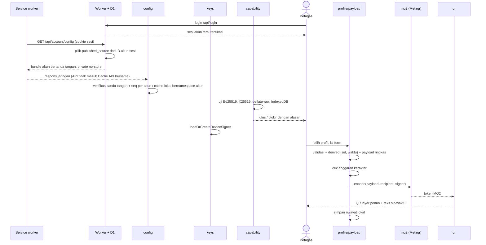

# AITQR — Architecture

Status: **DRAFT menunggu persetujuan** · 2026-11-25. Legenda: **[F]** fakta terverifikasi · **[A]** asumsi · **[?]** belum terverifikasi.
Pasangan dokumen: `PRD.md`, `AGENTS.md`. Konsumen pertama: `ZYBTool/ARCHITECTURE.md` (§6 kontrak QR).

## 1. Arsitektur yang direkomendasikan

**PWA mobile-first + Cloudflare Worker + D1**. Form, payload, tanda tangan QR petugas, dan render QR berjalan di browser HP; kunci Ed25519 akun tetap non-extractable di perangkat. Worker menangani login, administrasi akun, penyimpanan konfigurasi per akun, signing bundle admin, dan verifikasi token. D1 menyimpan akun/konfigurasi/audit/kunci decoder, bukan riwayat operasional petugas.

Dasar teknis, dari pembacaan repo Metaqr (`js/`, v0.4.0) [F]:
- Encoder JS tanpa dependensi: `encode(metadata, publicKey, {signer, compress, maxChars})` → string token (`MQ2:` bila ada `signer`). Pembuatan gambar QR **tidak** termasuk; AITQR harus menyediakan renderer QR sendiri.
- Kunci perangkat: `loadOrCreateDeviceSigner()` (Ed25519, **non-extractable**, di IndexedDB); mengembalikan `persisted`/`storageError`. JS halaman dapat menandatangani tetapi tidak dapat mengekspor kunci.
- Syarat runtime: WebCrypto Ed25519, X25519, HKDF, AES-GCM, `CompressionStream("deflate-raw")`, IndexedDB, secure context. Backend X25519 dapat disuntikkan (mis. `@noble/curves`); untuk Ed25519 tidak ada hook serupa.
- Batas token: default 800 karakter, **disarankan ≤ 400** (QR lebih kecil, lebih mudah dibaca). Token bertanda tangan ±126 karakter lebih panjang; contoh README: QR 65×65 modul vs 53×53 tanpa tanda tangan.
- Diuji di Node 22 dan Chromium 157; Safari/Firefox/Chrome terkini "seharusnya" mendukung, **uji di HP target** [?].
- Ada skrip `browser-check.cjs` (Playwright) dan vektor uji lintas-bahasa yang dapat dipakai ulang.

Pilihan implementasi [A, lihat PRD §12]: TypeScript tanpa framework UI berat, build minimal dan deterministik (lockfile), semua dependensi di-vendor dan di-pin.

## 2. Modul dan tanggung jawab

| Modul | Tanggung jawab | Murni? |
|---|---|---|
| `config` | Muat bundel (bawaan + fetch), verifikasi tanda tangan, anti-rollback, cache offline. | Logika ya; I/O lewat adapter |
| `profile` | Validasi profil terhadap skema `aitqr.profile/1`, resolusi daftar pilihan, aturan field. | Ya |
| `form` | Render form dari profil (satu renderer per tipe field); tanpa logika alat tertentu. | UI |
| `payload` | Pemetaan field → payload ringkas, kanonisasi, hitung anggaran karakter. | Ya |
| `mq2` | Adaptor tipis ke encoder Metaqr (salinan tak dimodifikasi, commit tercatat). | Adaptor |
| `keys` | Siklus hidup kunci perangkat, kode pendaftaran, deteksi kunci hilang. | Adaptor |
| `capability` | Deteksi fitur + swa-uji kripto saat mulai. | Adaptor |
| `qr` | Renderer QR (pustaka di-vendor) dan tampilan layar penuh. | UI |
| `history` | Riwayat penerbitan lokal (IndexedDB). | Adaptor |
| `pwa` | Service worker, cache berversi, alur pembaruan. | Platform |
| `i18n` | Bahasa Indonesia/Inggris. | Ya |
| `tools/` (Node, terpisah) | CLI admin: `lint-profile`, `budget`, `sign-bundle`, `make-vectors`, `registration-to-allowlist`. | CLI |

Batas: `config`, `profile`, `payload` tidak mengimpor DOM atau kripto platform; semua dapat diuji di Node tanpa browser.

## 3. Format bundel konfigurasi

```json
{
  "bundle": {
    "schema": "aitqr.bundle/1", "seq": 12, "issued": "2026-11-25T00:00:00Z", "max_age_days": null,
    "global": { "default_locale": "id", "require_persisted_key": true,
                "qr": { "ecc": "M", "quiet_modules": 4 } },
    "lists": { "locations": ["…"], "activities": ["…"], "shifts": [1, 2, 3] },
    "profiles": [ { "id": "zyb-recording", "version": 1, "…": "lihat PRD §5" } ]
  },
  "sig": { "alg": "Ed25519", "kid": "<kid admin>", "value": "<base64url>" }
}
```

- **Kanonisasi:** tanda tangan atas JSON kanonik (JCS, RFC 8785) dari objek `bundle`; deterministik lintas bahasa.
- **Kepercayaan:** daftar kunci publik admin tertanam di build aplikasi; rotasi kunci = rilis aplikasi baru [A].
- **Anti-rollback:** `seq` harus ≥ `seq` yang tersimpan; bundel lebih lama ditolak.
- **Pemilihan bundel:** bundel bawaan di build; pembaruan di-fetch dari origin yang sama; verifikasi gagal → tetap pakai bundel sah terakhir, tampilkan alasan.
- **Kenapa tanda tangan bundel kritis:** `recipient` (kunci publik decoder) ada di profil. Bundel palsu dapat mengalihkan enkripsi ke kunci penyerang (QR terbaca penyerang). Tanda tangan dan daftar kunci tepercaya mencegahnya.
- **Privasi bundel:** bundle akun tidak dipublikasikan sebagai static asset. Worker mengirim bundle terbit hanya kepada sesi akun yang sesuai (`GET /api/account/config`) dengan `Cache-Control: private, no-store` dan `Vary: Cookie`. Jangan memasukkan data pribadi yang tidak diperlukan ke field atau daftar opsi.

**Skema profil `aitqr.profile/1`** (ringkas; kontrak lengkap ada di repo):

| Kunci | Keterangan |
|---|---|
| `id`, `version` | Identitas profil; perubahan skema = versi baru (BR-07 PRD). |
| `consumer`, `schema_id` | Alat dan skema payload yang dimiliki alat tersebut. |
| `recipient` | `{kid, public}` decoder. Satu penerima per profil. |
| `fields[]` | `key`, `type` (`text`/`select`/`number`/`datetime`/`device_id`/`checkbox`/`constant`/`computed`), `label` (per bahasa), `required`, `max`, `pattern`, `list`, `short` (kunci ringkas di payload). |
| `derived[]` | Nilai otomatis: `session_id`, `device_clock`, `device_kid`, `profile`. Tidak dapat diubah operator. |
| `limits` | `max_token_chars` (default 800), `target_token_chars` (default 400). |
| `qr` | Override `ecc`, `min_display_ratio`. |

## 3.1. Kepemilikan konfigurasi per akun

Tabel D1 `account_configs` memiliki satu baris per `users.id`: `draft_source`, `published_source`, `draft_updated_at`, `draft_updated_by`, `published_at`, dan `published_seq`. Profil, field, label, daftar opsi, mapping payload, dan public key penerima berada di salinan bundle masing-masing akun.

- Pada migrasi, setiap akun lama mendapat salinan satu kali dari `bundle_draft` global yang sudah ada; akun baru mendapat salinan template yang sama saat dibuat.
- Setelah penyalinan, `bundle_draft` hanya menjadi template awal/kompatibilitas. Editor admin membaca dan menyimpan `account_configs` untuk akun terpilih; tidak ada draft bersama yang dipakai semua petugas.
- `PUT /api/admin/account-config` hanya menyimpan draf akun yang dipilih. `POST /api/admin/account-config/publish` memvalidasi bundle, menaikkan sequence milik akun itu, menandatangani bundle dengan `AITQR_ADMIN_KEY`, dan memakai compare-and-swap agar dua publikasi bersamaan tidak saling menimpa.
- `GET /api/account/config` mengambil ID akun dari sesi server yang sudah diverifikasi; klien tidak dapat meminta konfigurasi akun lain dengan mengganti parameter.
- Browser memverifikasi signature dan menyimpan cache offline dengan key yang mengandung ID akun. Service worker melewatkan seluruh `/api/*` secara network-only; Cache API bersama tidak pernah menyimpan respons yang terikat cookie.
- `settings.decoder_secret` tetap merupakan secret platform yang hanya digunakan Worker untuk verifikasi token decoder; field/profil/penerima tetap ada pada konfigurasi per akun.

## 4. Aliran data



**Payload (contoh; kontrak final dimiliki ZYB Tool [A]):**

```json
{ "p": "zyb-recording", "pv": 1, "s": "7QF3K9M2T8WX4R6B",
  "r": "<recorder>", "dn": "ZY005", "di": "box-20260819-81e2",
  "l": "<lokasi>", "a": "<aktivitas>", "sh": 2, "b": "MM3201" }
```

`iat` dan `kid` sudah berada di dalam token MQ2 (bagian yang ditandatangani) dan tidak diduplikasi di payload. Estimasi panjang token ±300–400 karakter [?] harus diukur dengan field nyata.

`session_id`: 80 bit acak (`crypto.getRandomValues`) dalam base32 Crockford 16 karakter [A]; unik secara praktis tanpa koordinasi server. Jam dan RNG disuntikkan agar uji deterministik.

## 5. Kunci dan kepercayaan

| Elemen | Aturan |
|---|---|
| Kunci perangkat | Dibuat saat pertama dipakai, non-extractable, disimpan IndexedDB (Metaqr `device.js`). `persisted=false` → blokir penerbitan bila `require_persisted_key` (default true). |
| Pendaftaran | UI menampilkan `kid`/kunci publik dan kode pendaftaran `{v,kid,pub,label,created}`. Admin mendaftarkan ke allowlist (`metaqr allowlist add allowlist.json --id <id> --pub <publicHex>` [F]); `tools/registration-to-allowlist` menghasilkan perintahnya. |
| Kunci hilang | Riwayat menyimpan `kid` terakhir; `created=true` padahal riwayat ada → peringatan keras + alur daftar ulang. Data situs dihapus atau di-evict (terutama iOS) [F README] menyebabkan ini. |
| Kunci decoder | Hanya kunci **publik** di profil; privat tidak pernah di AITQR. |
| Kunci admin bundel | Privat di luar repo dan di luar pipeline deploy; publik tertanam. |

Batas: kunci HP membuktikan **perangkat**, bukan orang; JS halaman yang berjalan (mis. XSS) dapat menandatangani selama halaman terbuka walau tidak dapat mengekspor kunci [F, komentar `device.js`].

## 6. Deteksi kapabilitas dan kegagalan

Saat mulai dan sebelum penerbitan pertama:
1. `isSecureContext`, `crypto.subtle`.
2. Swa-uji: generate/sign Ed25519; X25519 `deriveBits`; HKDF; AES-GCM; `compressionAvailable()`; buka IndexedDB.
3. Round-trip lokal: `encode` ke kunci uji sekali pakai lalu `decode`.

Gagal → layar blokir menyebut kapabilitas yang kurang dan versi browser; **tidak ada QR dan tidak ada penurunan ke token tanpa tanda tangan** (BR-06 PRD). Opsi fallback (X25519 via backend tersuntik) dapat dipasang bila perlu [F hook ada]; fallback **Ed25519** menuntut kunci perangkat berbasis seed yang dapat diekstrak (`signerFromSeed` [F ada]) sehingga lebih lemah → hanya bila diputuskan eksplisit dan diberi label di token/profil [?]. Alternatif backend signing tidak direkomendasikan (melemahkan bukti perangkat).

## 7. Tampilan QR

- Renderer: pustaka pembuat QR kecil, di-vendor dan di-pin [A; kandidat dipilih saat implementasi]. Metaqr tidak menyediakan gambar QR [F].
- Output SVG/canvas dengan zona tenang ≥ 4 modul, hitam di atas putih, tanpa logo/hiasan.
- ECC default M [A], dapat diubah per profil; tampilan layar penuh dengan ukuran modul dihitung dari viewport (`min_display_ratio`).
- Teks di bawah QR: `session_id` dan waktu penerbitan (acuan operator; bukan rahasia).
- Wake Lock API untuk menjaga layar menyala bila tersedia [? dukungan per browser]; tanpa itu, tampilkan peringatan layar mati.
- QR yang terlalu padat: anggaran karakter (§4) menjaga token ≤ 400 (target) / 800 (batas keras). Aturan ZYB Tool: QR harus cukup besar di frame kamera; Metaqr menyarankan sekitar 31% tinggi frame untuk keterbacaan [A dari README, **uji dengan kamera DECXIN nyata** pada jarak operasional].
- Default UI menerbitkan QR **baru** per sesi; menampilkan ulang QR yang sama hanya dari riwayat dengan label "ulang".

## 8. PWA dan offline

- Service worker precache cangkang aplikasi dan aset statis; cache berversi `aitqr-<build>`. Bundle petugas bukan aset static bersama.
- Seluruh `/api/*` dilewatkan langsung ke jaringan dengan `cache: no-store`; respons API ber-cookie tidak pernah ditulis ke Cache API yang tidak membedakan akun.
- Bundle terbit disimpan di localStorage setelah signature diverifikasi, memakai cache key yang memuat ID akun. Mode offline hanya boleh memakai bundle terverifikasi terakhir milik akun yang sama; akun tanpa cache sendiri diblokir sampai konfigurasi diambil online.
- CSP ketat: `default-src 'self'; script-src 'self'; style-src 'self'; img-src 'self' data:; connect-src 'self'; frame-ancestors 'none'`; tanpa skrip/font CDN, tanpa inline script.
- Manifest + "Add to Home Screen" disarankan; apakah PWA terpasang mengurangi eviction IndexedDB di iOS [?] harus diuji di perangkat target.
- Tanpa telemetri; jaringan browser hanya ke origin sendiri untuk sesi login, konfigurasi akun, dan fungsi admin yang berizin.

## 9. Kontrak lintas repo dengan ZYB Tool

| Aspek | Aturan |
|---|---|
| Kepemilikan | Skema payload `zyb-recording/v1` (JSON Schema) dimiliki repo ZYB Tool; AITQR menyalin versi ber-pin + hash. |
| Isi AITQR | Profil `zyb-recording` memetakan field ke skema itu; AITQR tidak mengetahui semantik ZYB. |
| Vektor uji | Repo ZYB Tool menerbitkan `vectors/`: kunci decoder **khusus uji**, masukan tetap (waktu, RNG, field), payload praenkripsi yang diharapkan, dan token hasil. |
| Uji AITQR | Dengan jam/RNG tersuntik, payload hasil AITQR harus sama byte-per-byte dengan vektor; token didekode memakai kunci uji. |
| Uji ZYB | CI men-decode token dari AITQR memakai decoder Python Metaqr (lintas bahasa) dan memvalidasi skema. |
| Perubahan | Skema baru = versi baru profil dan vektor baru; versi lama tetap valid selama `consumer` menerimanya. |

Profil alat lain mengikuti pola sama: konsumen memiliki skema; AITQR hanya menjalankan profil.

## 10. Threat model

| Ancaman | Mitigasi | Risiko sisa |
|---|---|---|
| Bundel konfigurasi palsu (alihkan penerima) | Tanda tangan admin, kunci tepercaya tertanam, `seq` anti-rollback | Kunci admin bocor |
| XSS | CSP ketat, tanpa pihak ketiga, tanpa inline script, dependensi di-vendor | XSS tetap dapat menandatangani selama halaman terbuka |
| Rantai pasok | Lockfile, versi pin, salinan Metaqr tanpa modifikasi dengan hash commit, audit dependensi di CI | Kompromi upstream |
| Kunci perangkat dicuri | Non-extractable; revoke `kid` di allowlist | Token sah antara pencurian dan revoke |
| Situs tiruan (phishing) | Kunci tiruan tidak terdaftar → `UNKNOWN_DEVICE` di ZYB Tool | Operator tertipu menampilkan QR palsu |
| QR difoto/disalin | Terenkripsi ke decoder; replay ditangani konsumen | Replay oleh pemegang HP sah |
| Operator salah isi `device_id` | Pola `device_id`, layar konfirmasi; ZYB Tool memeriksa C1 | Salah isi yang cocok dengan kamera lain |
| Jam HP salah | `iat` hanya klaim; konsumen memeriksa toleransi | — |
| HP hilang/dipinjam | Revoke `kid`; kunci per perangkat, bukan per orang | Pemakaian bersama tercatat sebagai satu identitas |
| Kebocoran konfigurasi akun | Endpoint sesi-terautentikasi memilih row D1 berdasarkan user ID sesi; `private, no-store`; service worker tidak cache `/api/*` | Admin account atau XSS tetap berisiko |
| Eviction kunci | Deteksi `created=true` + riwayat; blokir bila tak persisten | Kehilangan kunci sebelum disadari |

## 11. Deployment

- **Hosting:** HTTPS untuk PWA + Cloudflare Worker/Freebuff Sites untuk API, dengan D1 sebagai penyimpanan akun dan konfigurasi. Secure context wajib untuk WebCrypto [F].
- **Binding Worker:** `DB`, `ASSETS`, `APP_ORIGIN`; secret runtime `AITQR_ADMIN_KEY`, `AITQR_SESSION_KEY`, dan `AITQR_SETUP_CODE` di dashboard hosting, tidak pernah di repo atau bundle.
- **Signing bundle:** Worker menandatangani setiap bundle akun saat publikasi dengan secret `AITQR_ADMIN_KEY`; public key yang sesuai tertanam di `src/config/trustedAdminKeys.ts`. Kunci privat akun petugas tetap di perangkat dan tidak dikirim ke Worker.
- **Build:** deterministik (lockfile, versi pin); `npm run build` menghasilkan PWA di `dist/` dan Worker di `server/worker.js`.
- **Pemisahan tugas:** rilis kode aplikasi terpisah dari perubahan field akun. Administrator menyimpan lalu menerbitkan hanya akun terpilih; petugas mendapat bundle baru saat memuat ulang/refresh konfigurasi.
- **Pendaftaran perangkat:** administrator mencatat public key akun dan memperbarui allowlist konsumen sesuai proses ZYB Tool.

## 12. Pengujian

- **Unit (Node):** validator profil, pemetaan payload, anggaran karakter, kanonisasi JCS, verifikasi bundel dengan kunci uji, anti-rollback.
- **Properti:** pemetaan deterministik; anggaran monoton terhadap panjang input; `session_id` unik pada N penerbitan.
- **Vektor lintas bahasa:** §9; juga vektor bawaan Metaqr via `browser-check.cjs` (Playwright/Chromium) [F skrip ada].
- **Matriks perangkat nyata:** HP/browser target (D2): uji kapabilitas, penerbitan, persistensi kunci setelah reload/restart, perilaku eviction, mode offline, pembaruan PWA. Hasil dicatat per perangkat; perangkat gagal = tidak didukung.
- **Uji baca QR:** layar HP target → kamera DECXIN nyata pada jarak operasional; token bertanda tangan ±126 karakter lebih panjang berarti QR lebih padat [F].
- **Kebijakan:** CI memeriksa lint, tipe, uji, ukuran bundel, dan bahwa runtime tidak membuat permintaan ke luar origin.

## 13. Perbandingan alternatif

| Keputusan | Opsi | Dipilih / alasan |
|---|---|---|
| Penandatanganan | Kunci perangkat di browser · backend signing · aplikasi native · kunci software terekspor | **Browser, non-extractable**: bukti perangkat terkuat tanpa aplikasi khusus; backend signing mengubah bukti menjadi "server yang menandatangani"; native bertentangan dengan syarat tanpa aplikasi Android. |
| Hosting | HTTPS statis · server LAN · `file://` | **HTTPS statis**: secure context wajib; LAN butuh sertifikat tepercaya; `file://` bukan secure context untuk WebCrypto [A]. |
| Konfigurasi | Form tertanam kode · profil JSON ditandatangani · layanan form builder | **Profil JSON ditandatangani**: alat baru tanpa rilis, tanpa backend. |
| Pengiriman konfigurasi | Dibundel saja · fetch + cache | **Keduanya**: bawaan di build (offline pertama), pembaruan lewat fetch. |
| UI | Framework berat · TypeScript ringan | **Ringan** [A]: lebih deterministik, lebih kecil, lebih mudah diaudit. |

## 14. Belum terverifikasi

- Dukungan Ed25519/X25519/`deflate-raw` pada HP dan browser target (D2 PRD).
- Perilaku eviction IndexedDB dan efek PWA terpasang di iOS.
- Panjang token nyata dengan field profil `zyb-recording` dan keterbacaan QR oleh kamera DECXIN.
- Dukungan Wake Lock.
- Pustaka renderer QR yang dipilih (lisensi, ukuran, audit).
- Kebijakan hosting (akses terbatas) dan pemilik kunci admin bundel.
- Bentuk final skema `zyb-recording/v1` (dimiliki ZYB Tool).
