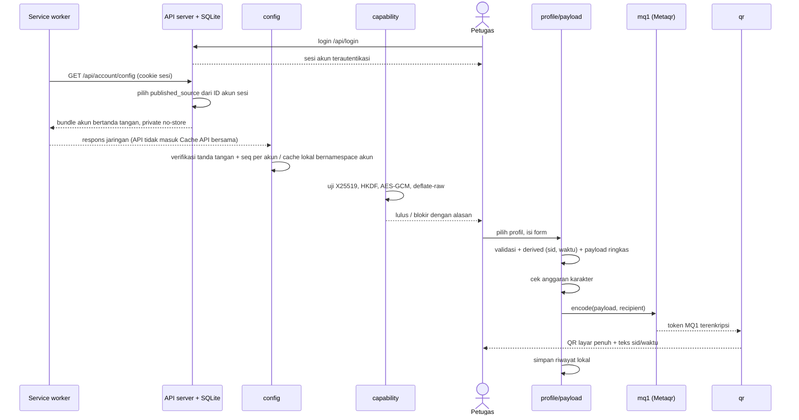

# AITQR — Architecture

Status: **DRAFT menunggu persetujuan** · 2026-11-25. Legenda: **[F]** fakta terverifikasi · **[A]** asumsi · **[?]** belum terverifikasi.
Pasangan dokumen: `PRD.md`, `AGENTS.md`. Konsumen pertama: `ZYBTool/ARCHITECTURE.md` (§6 kontrak QR).

## 1. Arsitektur yang direkomendasikan

**PWA mobile-first + Node.js HTTP API + SQLite**. Form, payload, enkripsi MQ1, dan render QR berjalan di browser HP. Tidak ada signing key per petugas. API server menangani login, administrasi akun, penyimpanan konfigurasi per akun, dan signing bundle admin. SQLite menyimpan akun/konfigurasi/audit serta ciphertext private key decoder yang dilindungi AES-256-GCM; plaintext key hanya dibuka sementara di backend untuk proses decrypt.

Dasar teknis, dari pembacaan repo Metaqr (`js/`, v0.4.0) [F]:
- Encoder JS `encode(metadata, recipientPublic, {compress, maxChars})` menghasilkan token MQ1 terenkripsi. Tanpa signer, tanpa tanda tangan QR.
- Penerbitan QR membutuhkan WebCrypto X25519, HKDF, AES-GCM, dan `CompressionStream("deflate-raw")` bila kompresi tersedia. Tidak membutuhkan IndexedDB atau Ed25519 per petugas.
- Verifikasi bundle konfigurasi admin tetap menggunakan Ed25519; itu terpisah dari QR operasional.
- Batas token: default 800 karakter, disarankan ? 400 agar QR lebih mudah dibaca.
- QR renderer `qrcodegen` di-vendor; Metaqr sendiri tidak menghasilkan gambar QR.
- Uji dilakukan di Node 22 dan Chromium 157; **uji di HP target** tetap diperlukan [?].

Pilihan implementasi [A, lihat PRD §12]: TypeScript tanpa framework UI berat, build minimal dan deterministik (lockfile), semua dependensi di-vendor dan di-pin.

## 2. Modul dan tanggung jawab

| Modul | Tanggung jawab | Murni? |
|---|---|---|
| `config` | Muat bundel (bawaan + fetch), verifikasi tanda tangan, anti-rollback, cache offline. | Logika ya; I/O lewat adapter |
| `profile` | Validasi profil terhadap skema `aitqr.profile/1`, resolusi daftar pilihan, aturan field. | Ya |
| `form` | Render form dari profil (satu renderer per tipe field); tanpa logika alat tertentu. | UI |
| `payload` | Pemetaan field → payload ringkas, kanonisasi, hitung anggaran karakter. | Ya |
| `mq1` | Adaptor tipis ke encoder Metaqr untuk encrypted-only MQ1. | Adaptor |
| `qr` | Renderer QR (pustaka di-vendor) dan tampilan layar penuh. | UI |
| `history` | Riwayat penerbitan lokal (IndexedDB). | Adaptor |
| `pwa` | Service worker, cache berversi, alur pembaruan. | Platform |
| `i18n` | Bahasa Indonesia/Inggris. | Ya |
| `tools/` (Node, terpisah) | CLI admin: `lint-profile`, `budget`, `sign-bundle`, `make-vectors`. Registrasi key hanya melalui Admin QR Inspector; tidak ada allow-list QR. | CLI |

Batas: `config`, `profile`, `payload` tidak mengimpor DOM atau kripto platform; semua dapat diuji di Node tanpa browser.

## 3. Format bundel konfigurasi

```json
{
  "bundle": {
    "schema": "aitqr.bundle/1", "seq": 12, "issued": "2026-11-25T00:00:00Z", "max_age_days": null,
    "global": { "default_locale": "id", "qr": { "ecc": "M", "quiet_modules": 4 } },
    "lists": { "locations": ["…"], "activities": ["…"], "shifts": [1, 2, 3] },
    "profiles": [ { "id": "zyb-recording", "version": 1, "…": "lihat PRD §5" } ]
  },
  "sig": { "alg": "Ed25519", "kid": "<kid admin>", "value": "<base64url>" }
}
```

- **Kanonisasi:** tanda tangan atas JSON kanonik (JCS, RFC 8785) dari objek `bundle`; deterministik lintas bahasa.
- **Kepercayaan:** daftar kunci publik admin tertanam di build aplikasi; rotasi kunci = rilis aplikasi baru [A].
- **Anti-rollback:** `seq` harus ≥ `seq` yang tersimpan; bundel lebih lama ditolak.
- **Pemilihan bundel:** bundel bawaan di build; pembaruan di-fetch dari origin yang sama; verifikasi gagal → tetap pakai bundel sah terakhir, tampilkan alasan.
- **Kenapa tanda tangan bundel kritis:** `recipient` (kunci publik decoder) ada di profil. Bundel palsu dapat mengalihkan enkripsi ke kunci penyerang (QR terbaca penyerang). Tanda tangan dan daftar kunci tepercaya mencegahnya.
- **Privasi bundel:** bundle akun tidak dipublikasikan sebagai static asset. API server mengirim bundle terbit hanya kepada sesi akun yang sesuai (`GET /api/account/config`) dengan `Cache-Control: private, no-store` dan `Vary: Cookie`. Jangan memasukkan data pribadi yang tidak diperlukan ke field atau daftar opsi.

**Skema profil `aitqr.profile/1`** (ringkas; kontrak lengkap ada di repo):

| Kunci | Keterangan |
|---|---|
| `id`, `version` | Identitas profil; perubahan skema = versi baru (BR-07 PRD). |
| `consumer`, `schema_id` | Alat dan skema payload yang dimiliki alat tersebut. |
| `recipient` | `{public}` decoder X25519. Satu penerima per profil; `kid` lama diabaikan. |
| `fields[]` | `key`, `type` (`text`/`select`/`number`/`datetime`/`device_id`/`checkbox`/`constant`/`computed`), `label` (per bahasa), `required`, `max`, `pattern`, `list`, `short` (kunci ringkas di payload). |
| `derived[]` | Nilai otomatis: `session_id`, `device_clock`, `device_kid`, `profile`. Tidak dapat diubah operator. |
| `limits` | `max_token_chars` (default 800), `target_token_chars` (default 400). |
| `qr` | Override `ecc`, `min_display_ratio`. |

## 3.1. Kepemilikan konfigurasi per akun

Tabel SQLite `account_configs` memiliki satu baris per `users.id`: `draft_source`, `published_source`, `draft_updated_at`, `draft_updated_by`, `published_at`, dan `published_seq`. Profil, field, label, daftar opsi, mapping payload, dan public key penerima berada di salinan bundle masing-masing akun.

- Pada migrasi, setiap akun lama mendapat salinan satu kali dari `bundle_draft` global yang sudah ada; akun baru mendapat bundle dasar dengan `profiles: []` dan `lists: {}`. Admin membuat atau mengimpor preset untuk akun baru sebelum menerbitkan profil operasional.
- Setelah penyalinan, `bundle_draft` hanya menjadi template awal/kompatibilitas. Editor admin membaca dan menyimpan `account_configs` untuk akun terpilih; tidak ada draft bersama yang dipakai semua petugas.
- `PUT /api/admin/account-config` hanya menyimpan draf akun yang dipilih. `POST /api/admin/account-config/publish` memvalidasi bundle, menaikkan sequence milik akun itu, menandatangani bundle dengan `AITQR_ADMIN_KEY`, dan memakai compare-and-swap agar dua publikasi bersamaan tidak saling menimpa.
- `GET /api/account/config` mengambil ID akun dari sesi server yang sudah diverifikasi; klien tidak dapat meminta konfigurasi akun lain dengan mengganti parameter.
- Browser memverifikasi signature dan menyimpan cache offline dengan key yang mengandung ID akun. Service worker melewatkan seluruh `/api/*` secara network-only; Cache API bersama tidak pernah menyimpan respons yang terikat cookie.
- Public key X25519 decoder berada pada konfigurasi profil per akun; private key decoder hanya masuk melalui registrasi HTTPS ke Vault dan tidak pernah disimpan plaintext.

## 4. Aliran data



**Payload (contoh; kontrak final dimiliki ZYB Tool [A]):**

```json
{ "p": "zyb-recording", "pv": 1, "s": "7QF3K9M2T8WX4R6B",
  "r": "<recorder>", "dn": "ZY005", "di": "box-20260819-81e2",
  "l": "<lokasi>", "a": "<aktivitas>", "sh": 2, "b": "MM3201" }
```

MQ1 tidak membawa signer `kid` atau signature; payload hanya dienkripsi ke public key decoder. Estimasi panjang token ±300–400 karakter [?] harus diukur dengan field nyata.

`session_id`: 80 bit acak (`crypto.getRandomValues`) dalam base32 Crockford 16 karakter [A]; unik secara praktis tanpa koordinasi server. Jam dan RNG disuntikkan agar uji deterministik.

## 5. Kunci dan batas kepercayaan

| Elemen | Aturan |
|---|---|
| Public key decoder | Disimpan pada profil akun AITQR. Admin menempelkan public key X25519 dari ZYBTool. |
| Private key decoder | Didaftarkan satu kali oleh admin melalui HTTPS, lalu disimpan sebagai ciphertext AES-256-GCM di Vault server. Plaintext tidak disimpan di browser, SQLite, log, bundel, atau build. |
| Kunci petugas | Tidak ada. Akun petugas hanya username/kata sandi; tidak ada keypair Ed25519, pairing, atau allow-list. |
| Kunci admin bundle | Private key Ed25519 tetap dipakai server untuk menandatangani bundle konfigurasi; public key tertanam di aplikasi. Ini bukan tanda tangan QR. |
| Batas MQ1 | MQ1 memberi kerahasiaan dan integritas enkripsi, tetapi tidak mengautentikasi siapa pembuat QR dan tidak menyediakan replay protection. |

Siapa pun yang mengetahui public key decoder dapat membuat QR MQ1 yang dapat didekripsi oleh private key pasangan. Jangan menampilkan `QR_DECRYPTED` sebagai bukti identitas petugas.


## 5.1. Decoder Key Vault dan QR Inspector

- `AITQR_VAULT_MASTER_KEY` wajib berupa 32 byte (64 karakter hex), disediakan sebagai secret environment server dan **tidak boleh** berada di SQLite, repository, image/container build, atau backup database.
- Private key X25519 per akun didaftarkan sekali oleh admin melalui halaman Admin → QR Inspector. Backend menurunkan public key dari private key dan hanya menerima registrasi bila cocok dengan salah satu `recipient.public` pada draft/published config akun tersebut.
- Database menyimpan `account_id`, fingerprint (`kid`), public key, IV acak, dan ciphertext AES-256-GCM. AAD/nonce tidak boleh dipakai ulang; setiap penyimpanan memakai IV acak 96-bit.
- Rotasi key menambah entri fingerprint baru; key lama tetap tersedia agar QR lama masih dapat didekripsi. Penghapusan key adalah tindakan destruktif dan harus dikonfirmasi.
- Endpoint decrypt hanya untuk sesi admin, memerlukan pemilihan akun eksplisit, menerima MQ1 saja, mencoba key terdaftar milik akun itu, dan tidak mengembalikan private key. QR MQ1 tidak memuat `kid` atau account ID sehingga akun tidak dapat diidentifikasi otomatis dari token.
- Log hanya mencatat aktor, akun, fingerprint, waktu, dan hasil; jangan pernah mencatat token, private key, atau plaintext payload.
- Backup SQLite **tidak cukup** untuk pemulihan. `AITQR_VAULT_MASTER_KEY` harus dicadangkan secara terpisah dalam password manager/secret manager. Kehilangan master key membuat semua key ciphertext tidak dapat dipulihkan.
- Kompromi server bersama master key memungkinkan akses ke seluruh private key terdaftar. Batasi administrator, harden VPS, gunakan HTTPS, batasi akses shell, dan rotasi master key hanya dengan prosedur re-enkripsi terencana.

## 6. Deteksi kapabilitas dan kegagalan

Sebelum penerbitan QR:
1. Pastikan `isSecureContext` dan `crypto.subtle` tersedia.
2. Uji X25519 key agreement, HKDF-SHA-256, AES-GCM, serta kompresi `deflate-raw` bila tersedia.
3. Jika X25519/AES-GCM tidak didukung, blokir penerbitan dengan pesan yang menyebut browser/runtime; tidak ada fallback kriptografi buatan sendiri.
4. Jika public key decoder salah format, tolak konfigurasi saat admin menyimpan/mempublikasikan profil.

Ed25519 tetap diperlukan untuk memverifikasi bundle konfigurasi admin yang ditandatangani server. Ed25519 tidak dipakai untuk QR petugas.

## 7. Tampilan QR

- Renderer: pustaka pembuat QR kecil, di-vendor dan di-pin [A; kandidat dipilih saat implementasi]. Metaqr tidak menyediakan gambar QR [F].
- Output SVG/canvas dengan zona tenang ≥ 4 modul, hitam di atas putih, tanpa logo/hiasan.
- ECC default M [A], dapat diubah per profil; tampilan layar penuh dengan ukuran modul dihitung dari viewport (`min_display_ratio`).
- Teks di bawah QR: `session_id` dan waktu penerbitan (acuan operator; bukan rahasia).
- Wake Lock API untuk menjaga layar menyala bila tersedia [? dukungan per browser]; tanpa itu, tampilkan peringatan layar mati.
- QR yang terlalu padat: anggaran karakter (§4) menjaga token ≤ 400 (target) / 800 (batas keras). Aturan ZYB Tool: QR harus cukup besar di frame kamera; Metaqr menyarankan sekitar 31% tinggi frame untuk keterbacaan [A dari README, **uji dengan kamera DECXIN nyata** pada jarak operasional].
- Default UI menerbitkan QR **baru** per sesi; menampilkan ulang QR yang sama hanya dari riwayat dengan label "ulang".

## 8. PWA dan offline

- Service worker precache cangkang aplikasi dan aset statis; cache berversi `aitqr-<build>`. Bundle petugas bukan aset static bersama.
- Seluruh `/api/*` dilewatkan langsung ke jaringan dengan `cache: no-store`; respons API ber-cookie tidak pernah ditulis ke Cache API yang tidak membedakan akun.
- Bundle terbit disimpan di localStorage setelah signature diverifikasi, memakai cache key yang memuat ID akun. Mode offline hanya boleh memakai bundle terverifikasi terakhir milik akun yang sama; akun tanpa cache sendiri diblokir sampai konfigurasi diambil online.
- CSP ketat: `default-src 'self'; script-src 'self'; style-src 'self'; img-src 'self' data:; connect-src 'self'; frame-ancestors 'none'`; tanpa skrip/font CDN, tanpa inline script.
- Manifest + "Add to Home Screen" disarankan; apakah PWA terpasang mengurangi eviction IndexedDB di iOS [?] harus diuji di perangkat target.
- Tanpa telemetri; jaringan browser hanya ke origin sendiri untuk sesi login, konfigurasi akun, dan fungsi admin yang berizin.

## 9. Kontrak lintas repo dengan ZYB Tool

| Aspek | Aturan |
|---|---|
| Kepemilikan | Skema payload `zyb-recording/v1` (JSON Schema) dimiliki repo ZYB Tool; AITQR menyalin versi ber-pin + hash. |
| Isi AITQR | Profil `zyb-recording` memetakan field ke skema itu; AITQR tidak mengetahui semantik ZYB. |
| Vektor uji | Repo ZYB Tool menerbitkan `vectors/`: kunci decoder **khusus uji**, masukan tetap (waktu, RNG, field), payload praenkripsi yang diharapkan, dan token hasil. |
| Uji AITQR | Dengan jam/RNG tersuntik, payload hasil AITQR harus sama byte-per-byte dengan vektor; token didekode memakai kunci uji. |
| Uji ZYB | CI men-decode token dari AITQR memakai decoder Python Metaqr (lintas bahasa) dan memvalidasi skema. |
| Perubahan | Skema baru = versi baru profil dan vektor baru; versi lama tetap valid selama `consumer` menerimanya. |

Profil alat lain mengikuti pola sama: konsumen memiliki skema; AITQR hanya menjalankan profil.

## 10. Threat model

| Ancaman | Mitigasi | Risiko sisa |
|---|---|---|
| Bundel konfigurasi palsu (alihkan penerima) | Tanda tangan admin, kunci tepercaya tertanam, `seq` anti-rollback | Kunci admin bocor |
| XSS | CSP ketat, tanpa pihak ketiga, tanpa inline script, dependensi di-vendor | XSS tetap dapat menandatangani selama halaman terbuka |
| Rantai pasok | Lockfile, versi pin, salinan Metaqr tanpa modifikasi dengan hash commit, audit dependensi di CI | Kompromi upstream |
| Database bocor | Ciphertext key dilindungi AES-256-GCM; master key terpisah dari SQLite | Jika server dan master key sama-sama dikompromikan, seluruh key dapat dibuka |
| Situs tiruan (phishing) | Kunci tiruan tidak terdaftar → `UNKNOWN_DEVICE` di ZYB Tool | Operator tertipu menampilkan QR palsu |
| QR difoto/disalin | Terenkripsi ke decoder; replay ditangani konsumen | Replay oleh pemegang HP sah |
| Operator salah isi `device_id` | Pola `device_id`, layar konfirmasi; ZYB Tool memeriksa C1 | Salah isi yang cocok dengan kamera lain |
| Jam HP salah | `iat` hanya klaim; konsumen memeriksa toleransi | — |
| HP hilang/dipinjam | Revoke `kid`; kunci per perangkat, bukan per orang | Pemakaian bersama tercatat sebagai satu identitas |
| Kebocoran konfigurasi akun | Endpoint sesi-terautentikasi memilih row SQLite berdasarkan user ID sesi; `private, no-store`; service worker tidak cache `/api/*` | Admin account atau XSS tetap berisiko |
| Eviction kunci | Deteksi `created=true` + riwayat; blokir bila tak persisten | Kehilangan kunci sebelum disadari |

## 11. Deployment

- **Hosting:** VPS mandiri menjalankan Node.js HTTP API dan SQLite persisten. Caddy menyediakan HTTPS dan reverse proxy ke 127.0.0.1:3000.
- **Database:** SQLite memakai WAL dan busy timeout; file data berada di luar direktori rilis. Skema dibuat otomatis oleh API saat pertama kali digunakan.
- **Environment:** APP_ORIGIN, AITQR_SESSION_KEY, AITQR_ADMIN_KEY, AITQR_SETUP_CODE, AITQR_PBKDF2_ITERATIONS, AITQR_VAULT_MASTER_KEY, AITQR_DATA_DIR, HOST, dan PORT. Secret dibaca dari environment/systemd EnvironmentFile dan tidak masuk repo.
- **Service:** systemd menjalankan node scripts/serve.mjs, restart saat gagal, dan bind hanya ke loopback; Caddy meneruskan HTTPS.
- **Build:** npm run build menghasilkan PWA di dist/ dan backend bundle server/app.js di luar direktori static assets.
- **Signing bundle:** API menandatangani bundle akun ketika dipublikasikan dengan AITQR_ADMIN_KEY; public key pasangannya tertanam di src/config/trustedAdminKeys.ts. Tidak ada private key QR per petugas.
- **Pemisahan tugas:** rilis kode aplikasi terpisah dari perubahan field akun. Administrator menyimpan lalu menerbitkan hanya akun terpilih; petugas mendapat bundle baru saat memuat ulang konfigurasi.
- **Pendaftaran perangkat:** administrator mencatat public key decoder X25519 di profil AITQR.
## 12. Pengujian

- **Unit (Node):** validator profil, pemetaan payload, anggaran karakter, kanonisasi JCS, verifikasi bundel dengan kunci uji, anti-rollback.
- **Properti:** pemetaan deterministik; anggaran monoton terhadap panjang input; `session_id` unik pada N penerbitan.
- **Vektor lintas bahasa:** §9; juga vektor bawaan Metaqr via `browser-check.cjs` (Playwright/Chromium) [F skrip ada].
- **Matriks perangkat nyata:** HP/browser target (D2): uji kapabilitas, penerbitan, persistensi kunci setelah reload/restart, perilaku eviction, mode offline, pembaruan PWA. Hasil dicatat per perangkat; perangkat gagal = tidak didukung.
- **Uji baca QR:** layar HP target → kamera DECXIN nyata pada jarak operasional; token bertanda tangan ±126 karakter lebih panjang berarti QR lebih padat [F].
- **Kebijakan:** CI memeriksa lint, tipe, uji, ukuran bundel, dan bahwa runtime tidak membuat permintaan ke luar origin.

## 13. Perbandingan alternatif

| Keputusan | Opsi | Dipilih / alasan |
|---|---|---|
| Penandatanganan | Kunci perangkat di browser · backend signing · aplikasi native · kunci software terekspor | **Browser, non-extractable**: bukti perangkat terkuat tanpa aplikasi khusus; backend signing mengubah bukti menjadi "server yang menandatangani"; native bertentangan dengan syarat tanpa aplikasi Android. |
| Hosting | HTTPS statis · server LAN · `file://` | **HTTPS statis**: secure context wajib; LAN butuh sertifikat tepercaya; `file://` bukan secure context untuk WebCrypto [A]. |
| Konfigurasi | Form tertanam kode · profil JSON ditandatangani · layanan form builder | **Profil JSON ditandatangani**: alat baru tanpa rilis, tanpa backend. |
| Pengiriman konfigurasi | Dibundel saja · fetch + cache | **Keduanya**: bawaan di build (offline pertama), pembaruan lewat fetch. |
| UI | Framework berat · TypeScript ringan | **Ringan** [A]: lebih deterministik, lebih kecil, lebih mudah diaudit. |

## 14. Belum terverifikasi

- Dukungan Ed25519/X25519/`deflate-raw` pada HP dan browser target (D2 PRD).
- Perilaku eviction IndexedDB dan efek PWA terpasang di iOS.
- Panjang token nyata dengan field profil `zyb-recording` dan keterbacaan QR oleh kamera DECXIN.
- Dukungan Wake Lock.
- Pustaka renderer QR yang dipilih (lisensi, ukuran, audit).
- Kebijakan hosting (akses terbatas) dan pemilik kunci admin bundel.
- Bentuk final skema `zyb-recording/v1` (dimiliki ZYB Tool).


## Keputusan protokol 2026-11-25

QR operasional memakai Metaqr MQ1 encrypted-only. AITQR tidak membuat kunci Ed25519 per petugas dan tidak menyediakan endpoint allow-list/decoder-secret. Public key X25519 decoder disimpan dalam profil per akun; private key hanya berada di ZYBTool. MQ1 tidak mengautentikasi pembuat QR dan tidak menyediakan replay protection. Ed25519 tetap dipakai hanya untuk menandatangani bundle konfigurasi admin.
