# AITQR — Product Requirements Document

Status: **DRAFT menunggu persetujuan** · Tanggal: 2026-11-25 · Snapshot implementasi tersedia di repo dan berstatus **WIP**, belum dinyatakan production-ready.
Repo GitHub: https://github.com/progstay17/AITQR (terpisah dari repo ZYBTool).

Legenda: **[F]** fakta terverifikasi · **[A]** asumsi · **[?]** belum terverifikasi (harus diuji sebelum dipakai).
Konsumen pertama adalah **ZYB Tool** (`ZYBTool/PRD.md`). AITQR sengaja **tidak mengenal** ZYB Tool; ia hanya mengenal *profil* konfigurasi. Detail teknis ada di `ARCHITECTURE.md`; aturan agent di `AGENTS.md`.

## 1. Problem statement

- Alat verifikasi butuh konteks tepercaya yang ditempel saat kejadian (siapa/di mana/apa/kapan), tetapi perangkat perekam tidak menyimpannya (ZYB Tool: blok `people` kamera kosong [F]).
- Tiap alat butuh field berbeda. Menanam form di kode per alat membuat web tool harus diubah dan dirilis ulang setiap ada alat baru atau daftar pilihan baru (lokasi, aktivitas, nomor device).
- QR harus ditandatangani perangkat dan dienkripsi ke decoder (Metaqr MQ2) agar tidak bisa dipalsukan atau dibaca pihak lain, dan harus berjalan di HP tanpa aplikasi Android khusus.

## 2. Goals dan non-goals

**Goals**
1. Web/PWA responsif yang menghasilkan QR MQ2 dari **profil** konfigurasi, tanpa perubahan kode untuk alat atau field baru.
2. **Pengaturan platform global** dan **konfigurasi form/profil per akun**. Setiap akun memiliki field, daftar opsi, profil, penerima/decoder, draf, serta publikasi yang terisolasi dari akun lain.
3. Konfigurasi didistribusikan sebagai bundel yang ditandatangani admin; HP menolak konfigurasi tak sah.
4. Manajemen kunci perangkat yang aman di browser, dengan alur pendaftaran ke allowlist alat.
5. Berjalan offline setelah dimuat sekali.
6. Kontrak jelas dengan konsumen: konsumen memiliki skema payload; AITQR menjalankannya.

**Non-goals**
- Memverifikasi atau men-decode QR (tugas tiap alat konsumen; kunci privat decoder tidak pernah masuk AITQR).
- Penyimpanan riwayat operasional petugas di backend; riwayat penerbitan tetap lokal pada perangkat. SQLite menyimpan akun, konfigurasi profil, audit administratif, dan kunci decoder yang dikelola admin.
- Backend signing untuk QR petugas. QR tetap ditandatangani di browser oleh kunci akun; API server hanya menandatangani bundel konfigurasi admin.
- Membuktikan identitas orang pemegang HP (hanya perangkat penanda tangan).
- Membuat ulang kriptografi; memakai encoder JS Metaqr.

## 3. Peran

| Peran | Tugas |
|---|---|
| Petugas | Memilih profil, mengisi form, menerbitkan dan menampilkan QR. |
| Administrator profil | Menulis/mengubah profil dan daftar pilihan, menandatangani bundel konfigurasi, mengelola allowlist alat konsumen. |
| Integrator alat | Mendefinisikan skema payload alat (mis. ZYB Tool) dan memakainya di profil. |

## 4. Alur end-to-end

```mermaid
flowchart LR
  A[Admin pilih akun lalu edit profil + daftar pilihan] --> B[Simpan draf dan terbitkan untuk akun terpilih]
  B --> C[API server simpan bundle bertanda tangan per akun]
  C --> D[HP login dan mengambil bundle milik akunnya]
  D --> E[HP verifikasi tanda tangan; petugas pilih profil dan isi form]
  E --> F[Validasi + susun payload + cek anggaran ukuran]
  F --> G[Encode MQ2: tanda tangan kunci perangkat, enkripsi ke decoder]
  G --> H[Tampilkan QR layar penuh]
  H --> I[Alat konsumen men-decode dan memverifikasi]
```



## 5. Model konfigurasi (inti produk)

Konfigurasi dipisah menurut kepemilikan:

**Pengaturan platform global**: bahasa/tema default, kunci publik admin tepercaya, kebijakan keamanan perangkat, serta kebijakan pembaruan aplikasi. Pengaturan ini tidak menjadi tempat menyimpan field operasional petugas.

**Konfigurasi per akun**: setiap akun mempunyai salinan bundle sendiri yang mencakup profil, `fields`, `lists`, `derived`, `payload`, penerima/decoder, batasan, dan opsi render QR. Administrator memilih akun di konsol, mengubah draf akun itu, menyimpan, lalu menerbitkan hanya untuk akun tersebut. Setiap akun mempunyai `published_seq` sendiri.

Akun baru menyalin template awal satu kali. Pada migrasi, akun lama menyalin draf global yang sudah ada satu kali agar pekerjaan admin sebelumnya tidak hilang. Setelah itu, semua salinan independen: perubahan field, daftar pilihan, atau profil akun A tidak mengubah akun B. Draf yang belum diterbitkan tidak dikirim ke petugas.

Setiap bundle yang diterbitkan ditandatangani Ed25519. Petugas mengambil bundle melalui endpoint autentikasi yang memilih konfigurasi dari ID akun di sesi server. Klien memverifikasi signature dan menyimpan cache offline dengan namespace ID akun; service worker tidak menyimpan respons API terautentikasi ke cache bersama.

Tipe field: `text`, `select` (opsi dari daftar), `number`, `datetime`, `device_id`, `checkbox`, `constant`, `computed`. Daftar pilihan (`lists`) dapat diperbarui tanpa merilis ulang aplikasi.

Contoh profil (ilustrasi untuk ZYB Tool; **bukan skema final**, kontrak final dimiliki ZYB Tool [A]):

```json
{
  "id": "zyb-recording", "version": 1, "title": "Rekaman ZYB",
  "consumer": "zyb-tool", "recipient": { "kid": "decoder-admin-01", "public": "<hex 64 karakter>" },
  "schema_id": "zyb-recording/v1",
  "fields": [
    { "key": "recorder",  "type": "text",   "label": "Nama petugas", "required": true, "max": 40 },
    { "key": "device_no", "type": "select", "label": "Nomor device", "list": "devices", "required": true },
    { "key": "device_id", "type": "device_id", "label": "ID kamera", "required": true },
    { "key": "location",  "type": "select", "label": "Lokasi/ruangan", "list": "locations", "required": true },
    { "key": "activity",  "type": "select", "label": "Aktivitas", "list": "activities", "required": true },
    { "key": "shift",     "type": "select", "label": "Shift", "list": "shifts", "required": true },
    { "key": "batch",     "type": "text",   "label": "Kode batch (MM…)", "required": true, "pattern": "^MM\\d{2,4}$" }
  ],
  "derived": [
    { "key": "sid",    "type": "computed", "source": "session_id" },
    { "key": "issued", "type": "computed", "source": "device_clock" }
  ],
  "limits": { "max_token_chars": 800, "target_token_chars": 400 },
  "qr": { "ecc": "M", "min_display_ratio": 0.5 }
}
```

## 6. Kebutuhan fungsional

| ID | Kebutuhan |
|---|---|
| FR-01 | Muat bundle terbit milik akun yang sedang login lewat endpoint terautentikasi; verifikasi tanda tangan admin dan anti-rollback per akun; cache offline dipisah per ID akun. Bundle tak sah ditolak. |
| FR-02 | Render form dari profil; validasi (wajib, panjang, pola, opsi); tampilkan galat jelas. |
| FR-03 | Field turunan otomatis: `session_id` unik, waktu perangkat; operator tidak dapat mengubahnya. |
| FR-04 | Susun payload sesuai profil, hitung anggaran ukuran token (batas MQ2) dan blokir jika terlampaui, tampilkan sisa. |
| FR-05 | Encode MQ2 dengan encoder JS Metaqr memakai kunci perangkat dan kunci publik decoder dari profil. |
| FR-06 | Tampilkan QR layar penuh, kontras tinggi, ukuran modul sesuai konfigurasi; opsi menjaga layar tetap menyala [? dukungan browser]. |
| FR-07 | Kunci perangkat: buat saat pertama pakai (non-extractable), tampilkan `kid`/kunci publik, ekspor kode pendaftaran untuk allowlist alat, peringatkan bila kunci hilang. |
| FR-08 | Deteksi kapabilitas WebCrypto (Ed25519, X25519) saat mulai; bila tidak didukung, **blokir dengan pesan jelas**, tidak ada penurunan ke token tak bertanda tangan. |
| FR-09 | Riwayat penerbitan lokal di perangkat (session_id, profil, waktu); tidak dikirim ke mana pun. |
| FR-10 | PWA offline; bahasa Indonesia dan Inggris. |
| FR-11 | Konsol admin menyediakan CRUD akun dan editor profil/field/daftar opsi per akun; simpan draf dan terbitkan konfigurasi hanya untuk akun terpilih, selain alat lint, anggaran, signing, dan vektor uji. |

## 7. Kebutuhan non-fungsional

- **Keamanan:** HTTPS (secure context) [F: syarat WebCrypto]; CSP ketat; tanpa skrip pihak ketiga saat runtime; tanpa telemetri berisi data operasional; kunci publik admin tertanam di aplikasi.
- **Kompatibilitas:** harus lulus uji pada HP target; daftar perangkat/browser target [?] ditetapkan pemilik.
- **Performa:** muat awal dan encode terasa instan pada HP kelas menengah [?] diukur.
- **Privasi:** payload (termasuk nama petugas) dienkripsi ke decoder; tidak disimpan server.
- **Maintainability:** engine profil terpisah dari UI dan dari lapisan kripto; tanpa dependensi kripto baru.

## 8. Aturan bisnis

- **BR-01:** kunci privat decoder tidak pernah ada di AITQR (hanya kunci publik penerima).
- **BR-02:** kunci tanda tangan perangkat non-extractable; tidak diekspor, tidak dikirim ke server.
- **BR-03:** profil tidak dikenal, versi tidak dikenal, atau bundel tak bertanda tangan sah → tidak ada QR yang diterbitkan.
- **BR-04:** setiap QR membawa `profile` + `version` + `session_id` unik; satu QR untuk satu sesi, UI default menerbitkan QR baru.
- **BR-05:** AITQR tidak mengklaim identitas pemegang HP; hanya perangkat yang menandatangani.
- **BR-06:** tidak ada penurunan keamanan otomatis (mis. QR tanpa signature) saat kapabilitas kurang.
- **BR-07:** skema payload dimiliki konsumen; perubahan skema = versi baru profil, bukan perubahan diam-diam.

## 9. Kriteria penerimaan

| ID | Kriteria |
|---|---|
| AC-01 | Menambahkan profil baru lewat bundel (tanpa mengubah kode) memunculkan form baru di aplikasi. |
| AC-02 | Bundel dengan tanda tangan salah/diubah ditolak; aplikasi tetap memakai bundel sah terakhir dan menampilkan alasan. |
| AC-03 | Payload melebihi anggaran token diblokir dengan pesan yang menyebut field penyebab. |
| AC-04 | QR hasil AITQR terbaca dan lolos verifikasi oleh decoder Python Metaqr memakai vektor uji bersama. |
| AC-05 | Dua profil dengan decoder berbeda menghasilkan token yang hanya dapat didekripsi oleh decoder masing-masing. |
| AC-06 | Setelah muat pertama, aplikasi menerbitkan QR tanpa jaringan. |
| AC-07 | Kunci perangkat bertahan setelah reload dan tidak dapat diekspor. |
| AC-08 | Browser tanpa dukungan kripto yang dibutuhkan menampilkan pesan blokir, tanpa QR. |
| AC-09 | Dua penerbitan berurutan menghasilkan `session_id` berbeda. |
| AC-10 | Profil ZYB (`zyb-recording`) menghasilkan payload yang lolos validasi skema ZYB Tool. |
| AC-11 | Dua akun memiliki field dan daftar opsi berbeda; menyimpan/menerbitkan akun A tidak mengubah draft/publikasi akun B, dan setiap sesi hanya menerima bundle akun sendiri. |

## 10. Edge case dan penanganan kegagalan

| Kasus | Penanganan |
|---|---|
| Data situs dihapus / kunci di-evict (terutama iOS) | Deteksi `kid` tersimpan di riwayat tapi kunci hilang → peringatan; buat kunci baru dan minta pendaftaran ulang. |
| Browser lama tanpa Ed25519/X25519 | Blokir (BR-06). Opsi polyfill (kunci extractable) hanya jika diputuskan eksplisit [?]. |
| Jam HP salah | `iat` hanya klaim; tampilkan peringatan jika selisih besar dengan jam yang dapat diperiksa [?]. |
| Payload terlalu panjang | Blokir; saran memperpendek/menghapus field. |
| Bundel kedaluwarsa atau pembaruan gagal | Pakai bundel sah terakhir; tampilkan umur bundel; kebijakan batas umur dapat dikonfigurasi. |
| Dua petugas memakai HP yang sama | Kunci per perangkat, bukan per orang; dicatat sebagai batas bukti. |
| QR sulit terbaca kamera | Ukuran/ECC dari profil; uji fisik dengan kamera nyata sebelum rilis [?]. |

## 11. MVP dan roadmap

| Tahap | Isi |
|---|---|
| M1 | Engine profil + form + payload + encode MQ2 + render QR; satu profil contoh. |
| M2 | Kunci perangkat + deteksi kapabilitas + uji HP target + uji baca QR dengan kamera nyata. |
| M3 | Bundel konfigurasi bertanda tangan + alat admin (lint, sign, vektor uji). |
| M4 | PWA offline + i18n + riwayat lokal. |
| M5 | Profil `zyb-recording` + uji kontrak lintas repo dengan ZYB Tool. |
| Roadmap | Alat tambahan lewat profil baru, multi-penerima, kunci perangkat berbasis atestasi (bila tersedia), sumber daftar pilihan dinamis. |

## 12. Keputusan terbuka

| ID | Pertanyaan | Catatan |
|---|---|---|
| SQLite | Hosting (HTTPS statis) dan pemeliharaan. | [A] hosting statis; pemilik sudah memakai Vercel untuk alat lain. |
| D2 | Daftar HP/browser target untuk uji WebCrypto. | Menentukan perlu tidaknya fallback. |
| D3 | Penyimpanan kunci penandatangan bundel admin. | Risiko utama rantai kepercayaan konfigurasi. |
| D4 | Sumber waktu: jam perangkat saja atau ada cek tambahan. | Mempengaruhi toleransi di ZYB Tool. |
| D5 | Daftar pilihan statis dalam bundel vs diperbarui terpisah. | Cakupan FR-01. |
| D6 | Multi-penerima (satu QR untuk lebih dari satu alat). | MQ2 mengenkripsi ke satu penerima [F: SPEC Metaqr]; default satu QR per alat. |
| D7 | Kebijakan kunci hilang dan pendaftaran ulang. | Proses admin. |
| D8 | Nama repo GitHub. | Diputuskan: progstay17/AITQR. |
